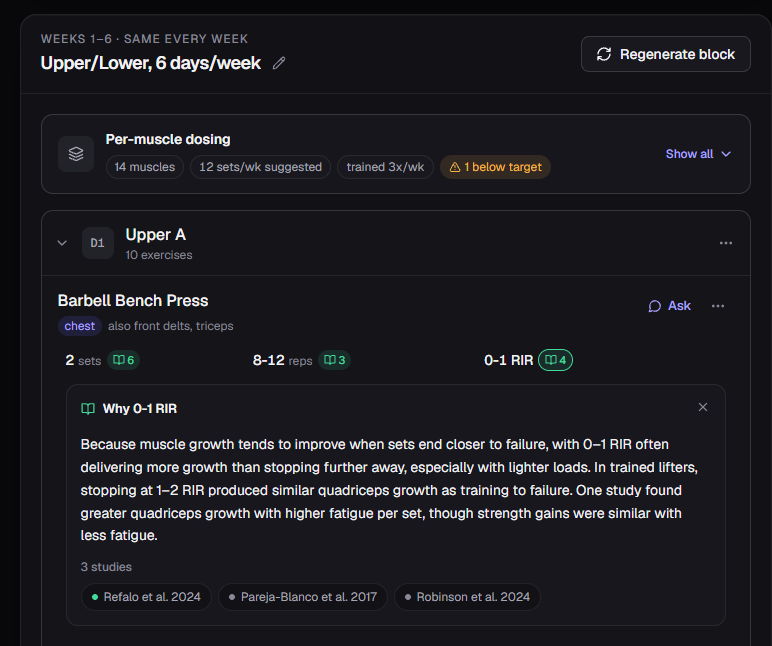
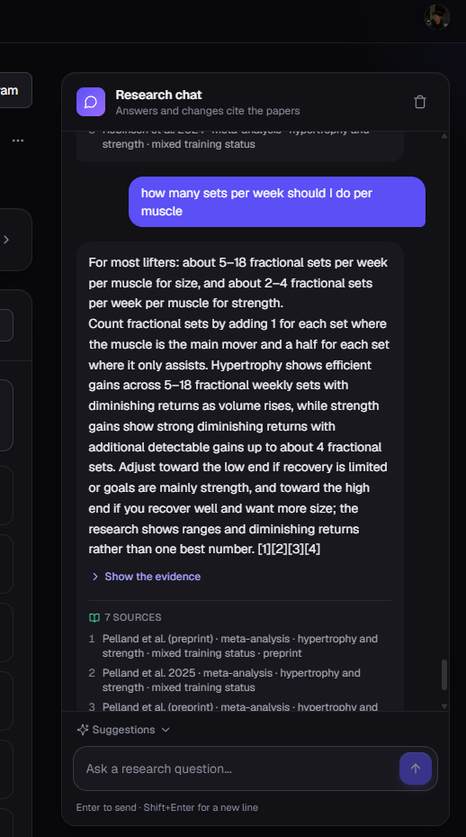
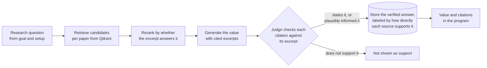

# AI Workout Tracker

[](https://github.com/Kyzzo/Workout-RAG-system/actions/workflows/backend-tests.yml)
[](https://github.com/Kyzzo/Workout-RAG-system/actions/workflows/frontend-checks.yml)

A workout program generator where **every number cites its own research**.

Most AI fitness tools generate a whole program and attach sources to it
in bulk. This one attributes each individual value, such as the sets, reps
or effort for one exercise in one week, to the specific study excerpts
that support it. A separate judge checks every citation before it is
shown. You can open any number, see exactly why it is there, and decide
whether to trust it or override it.



## What it does

- **Builds a full training block** from a goal, a split, days per week and
  a block length. Every set count, rep range, effort target and load is
  generated from a corpus of 50 strength-training research papers.
- **Cites each value separately.** Each badge opens a plain-language
  explanation and the studies behind it, with excerpts.
- **Answers research questions in chat.** Each claim in an answer is
  checked against its cited excerpts, not just the answer as a whole.
- **Edits through chat.** You can ask for a set to be added, an exercise
  swapped, or the reasoning behind a value explained. Every change can be
  undone.



## How a value gets its citation



Self-reported citations are often wrong, so nothing is trusted on the
model's word. Questions are asked at the level the research answers them,
so a verified answer is computed once and reused by every program with
the same setup.

## Measured results

| What was measured | Result |
|---|---|
| Expected papers found by the retrieval eval | 23 of 23 |
| Large-model calls per program, before shared answers | about 590 |
| Large-model calls, first program of a setup | 29 |
| Large-model calls, later programs with the same setup | 0, in about 20 seconds |
| Chat claims checked against their cited excerpts (34 questions, 185 claims) | 88% faithful, 12% minor slips, 0.5% unfaithful |
| Unfaithful lead answers in that audit, before and after the latest fixes | 3, then 0 |
| Chat answer, median time and cost | about 20 seconds, about $0.11 |
| Questions the corpus can't answer | declined in about 6 seconds, about $0.03 |
| Summary judge regression cases, 5 runs per case | 35, all passing except 3 known gaps |
| Backend tests, all model calls mocked | 200+ |

How each number was measured, and what was wrong before it, is written up
in [docs/](docs/README.md). The chat audit was graded by a language model
against each cited excerpt, on one run of each question.

## Known limitations

- **A study's setup can be presented as advice.** Asked how long a
  workout should take, the chat can answer "about 30 minutes" because one
  trial's sessions lasted that long. A judge check that catches this was
  built and measured: it worked on the regression cases, but in a full
  42-question rerun it rejected half of the good first drafts and raised
  the median answer time from 20 to 35 seconds. It was reverted. The
  failing cases stay in the eval as known gaps.
- **Advice can be moved to a population the study didn't cover**, such as
  telling beginners what a study of trained lifters found. Also a known
  gap in the eval.
- **About one claim in eight is a minor slip**: true in spirit but looser
  than its source, such as a figure stated more firmly than the study
  does.

## Read more

- [Field-level citation attribution](docs/design-decisions/field-level-citation-attribution.md)
  is the best single document on what this project does differently.
- [Citation verification pipeline](docs/design-decisions/citation-verification-pipeline.md)
  covers how a citation is checked rather than trusted.
- [Accuracy hardening](docs/engineering-log/accuracy-hardening.md) tells
  the story of one wrong answer and everything it led to.
- [Initial planning documents](initial-planning/README.md) show the
  original plan and how it changed.

## Stack

| Layer | Tools |
|---|---|
| Frontend | Next.js, TypeScript, Tailwind CSS, Clerk |
| Backend | FastAPI, SQLAlchemy, Alembic, PostgreSQL |
| Retrieval | Qdrant, OpenAI embeddings, Inngest for ingestion jobs |
| Generation and judging | OpenAI models with structured outputs |

## Repository layout

| Folder | Contents |
|---|---|
| [backend/](backend/README.md) | FastAPI app, retrieval and verification code, tests, eval scripts |
| [frontend/](frontend/README.md) | Next.js app |
| [docs/](docs/README.md) | Design decisions and engineering logs |
| [initial-planning/](initial-planning/README.md) | The original plans, kept as written |

## Running it locally

You need Docker, Python 3.11 with uv, Node.js, a Clerk app, a Qdrant
instance and an OpenAI API key.

```bash
docker compose up -d                    # Postgres
cd backend && uv sync && uv run alembic upgrade head
uv run uvicorn app.main:app --port 8000 --reload
cd ../frontend && npm install && npm run dev
```

The [backend README](backend/README.md) lists the environment variables
and covers ingestion.

**About the research papers.** The PDFs are not in this repository for
copyright reasons. The full list of papers, with citations and tags, is
in [backend/corpus/papers.json](backend/corpus/papers.json). The backend
tests run without the corpus. Ingestion, retrieval and real generation
need the PDFs placed at the paths that file lists.
